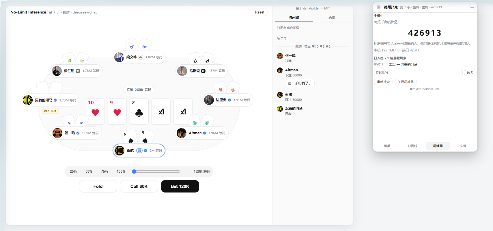
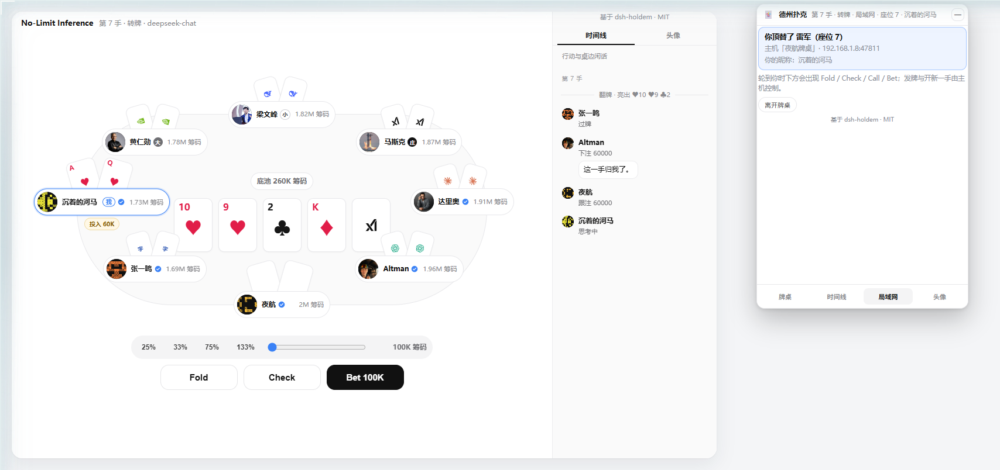
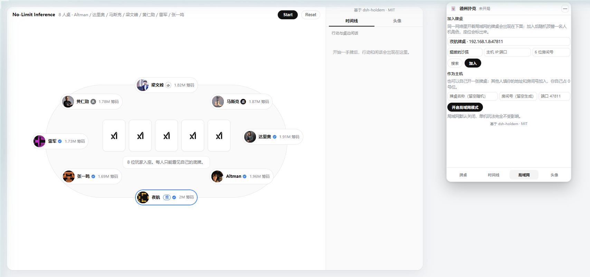
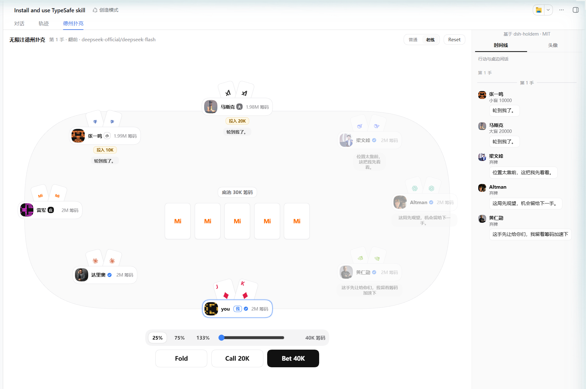

# dsh-poker-night

无限注德州扑克：**1 名玩家 + 7 位 LLM 智能体**（Altman、达里奥、马斯克、梁文峰、黄仁勋、雷军、张一鸣），固定八人桌。装上后，Web GUI 中间栏会出现「德州扑克」Tab，
会话区域还会浮着一个可拖动、可收起的小窗。

智能体只能看见自己的底牌；桌边闲话是中文，不会泄露推理或手牌。

> 本仓库是 [`BubblePtr/dsh-holdem`](https://github.com/BubblePtr/dsh-holdem) 的 fork（MIT），
> 在上游基础上继续开发：局域网联机、固定八人桌与两位新角色、体验优化。上游的版权与许可声明保留在 `LICENSE`。

## 致谢

牌局引擎、会话隔离、桌面版适配、悬浮小窗、头像机制、亮牌与翻牌动效这些基础能力，来自上游项目
**[`BubblePtr/dsh-holdem`](https://github.com/BubblePtr/dsh-holdem)**（MIT）——向它的作者与贡献者致谢。
本 fork 在其之上继续开发：局域网联机、固定八人桌与雷军 / 张一鸣两位角色、以及若干体验优化。

上游的版权声明保留在 [`LICENSE`](LICENSE) 中，界面（侧栏与小窗）也常驻「基于 dsh-holdem · MIT」署名。


## 局域网联机

同一网络里的两台机器可以坐同一张桌：一台当主机，另一台加入后**随机顶替一名人机角色**。
加入后界面会明确告诉你**顶替了谁、坐在几号位**，轮到你时下注按钮照常出现。
默认关闭：不开启时插件不占端口、不发广播，单机玩法完全不受影响。

小窗底部点「局域网」，面板是两块互不相干的操作（加入别人的桌不必先开自己的房间）：

- **作为主机**：填牌桌名称（留空随机，如「夜航牌桌」）、可自定义 6 位房间号（留空自动生成）、
  端口（默认 47811）→「开启局域网模式」。之后大号字显示房间号，下面列出**已入座的远程玩家**
  （`座位 7　雷军 → 沉着的河马`），还能就地改自己的昵称。
- **加入牌桌**：填昵称（留空随机，如「沉着的河马」）、`主机IP:端口`、6 位房间号 →「加入」。
  面板会先用 UDP 广播列出同网络的牌桌，点一下填进地址栏；企业网络挡住广播时手动填地址即可。



### 座位与昵称

- 加入成功后小窗第一行是「**你顶替了 雷军（座位 7）**」，桌面上该座位带蓝色描边与「我」标记，
  窗口标题写着 `局域网 · 座位 7 · 沉着的河马`。
- 轮到你时下方出现 Fold / Check / Call / Bet。发牌、下一手、Reset 归主机，客人端不显示这些按钮，
  改为「等待主机开局」/「等待主机发下一手」。
- 昵称：开房时填的既是牌桌名也是主机自己的昵称，加入时填的是客人昵称；座位显示昵称，
  主机面板显示「原角色 → 昵称」的对应关系，离开或掉线时两者一起还原。
- 离开、掉线 20 秒 → 座位自动交还那名角色，人机接着打；主机重启或关掉局域网时，
  客人端提示「与主机失去联系，已退回自己的牌桌」并回到自己的八人桌。





> 截图是把仓库构建出的 `lib/client.js` 与真实 CSS 挂在最小宿主壳里、喂真实形状快照渲染的，
> 用插件默认浅色配色（在宿主深色主题下会跟随宿主变量）。

安全设计：**广播里不含房间号**（能看见牌桌存在，但只有被口头告知房间号的人能加入）；
每一份快照都按「观看者座位」生成，所以每个玩家只看得见自己的底牌——主机也一样看不见客人的牌。
详见 [`docs/adr/0005-lan-rooms.md`](docs/adr/0005-lan-rooms.md)。

## 安装

### 桌面版

桌面版（DeepSeek Harness.app）自带一套 dsh CLI，装到它自己的 `desktop` profile：

```sh
"/Applications/DeepSeek Harness.app/Contents/Resources/runtime/cli/bin/dsh" plugin --profile desktop add dsh-poker-night
```

装完桌面版会热重载 profile 并把新的客户端模块推给页面，通常不用重启；如果「德州扑克」Tab 没出现，退出重开桌面版。

### Web

```sh
dsh plugin --profile web add dsh-poker-night
dsh --profile web
```

装的是 npm 上的预构建包，不用 clone、不用 build、不用 `allowBuilds`。

卸载（把 profile 与 CLI 换成对应的一套）：

```sh
dsh plugin --profile web remove dsh-poker-night
```

## 开发

```sh
pnpm install
pnpm build
```

| 文件 | 作用 |
| --- | --- |
| `src/host.js` | Node 半区：牌局引擎 + `/dsh-poker-night/*` JSON API；缺模型时回退启发式机器人 |
| `src/client.cjs` | 浏览器半区：`conversation.view` Tab + `shell.overlay` 悬浮小窗 |
| `cordis.patch.yml` | 往 web 组合插入本包 |

改 Host 后需要重启 `dsh --profile web`。改 Client 后重新 `pnpm build`、刷新页面。

## AI 难度与座位轮转

两档难度，牌桌右上角切换（小窗里是 `AI 老练` 按钮）：



- **普通**：原版手感——按牌力阈值打，很少诈唬。
- **老练**（默认）：prompt 里直接给出底池赔率（`跟注额 ÷ (底池 + 跟注额)`），要求赔率不够就弃牌；
  启发式兜底也改成「胜率达到赔率才跟」，按底池比例下价值注，并在人少时以较低频率诈唬抢池。
  人多时诈唬率自动降低——对着七个对手乱诈只是白送筹码。

`Start` 与 `Reset` 都会把难度恢复成「老练」，想回到轻松模式再手动切「普通」，档位不会写死。

**每次重开都重新洗座位**：7 位智能体在 1~7 号位随机就座（`src/cards.js` 的 `shuffle`，不播种），
你固定在 0 号位——局域网客人的 `you` 语义依赖「主机永远是 0 号位」，让 hero 换座位会把这套约定
弄成二义。连续点 Reset 会看到完全不同的座位顺序。

策略本身是纯函数 `src/ai-difficulty.js`（`normalChoice` / `sharpChoice`），引擎只负责把牌局算成
一份快照；两档的差异、默认值与「重开换座位」由 `test/ai-difficulty.test.mjs` 与
`test/difficulty.test.mjs` 钉住。

## 下注尺度

`legalFor` 的 `maxRaiseTo` 是**智能体的全部筹码**，所以直接把合法区间丢给模型会出事：
模型常在区间里挑一个"看起来挺大"的数，于是每次加注都静默变成全下（上游修过同一类问题的
客户端版本，见 `f90bd7e`）。现在 host 侧统一按底池给尺度：

- prompt 里给的是**底池倍数**区间 `minRaiseTo – currentBet + 3 × 底池`，并单独列出 `allin`
  作为"整副筹码"的显式选项，不再是加注区间的上界。
- 非 `allin` 的加注一律过 `clampRaise`（`src/bets.js`）：落在 `[minRaiseTo, 上限]` 内。
  只有显式选 `allin` 才会推光；底池已经很大时上限自然超过筹码，那时"合法加注就是全下"仍然成立。
- 启发式兜底 `decideAi` 的额度也走同一条钳制——它原先会算出超过自己筹码的加注额，在 LLM
  报错的回退路径上绕过 `normalizeChoice`，等于意外推光。

规则与边界都在 `test/bets.test.mjs`（纯函数）和 `test/ai-sizing.test.mjs`（stub 掉 llm 服务、
离线跑完整 AI 决策链路）里钉住。

## 买入与出局

每人起始 200 万，**外加 3 次买入**（也就是 4 条命）。筹码输光后：

- 下一手开始前自动补回 200 万，日志写明「重新买入 2000000（第 N/3 次）」；
- 3 次用完后再破产就**出局**：bot 坐观退场，不再发牌、不再被收盲注、不再参与行动；
- 你出局则本局结束（`status: 'game-over'`），界面显示结束横幅，只能 `Reset` 再开一桌；
- 桌面上只剩一名玩家时同样结束（等于打通关）。

界面上每个玩家行、每个座位都会显示「买入 N/3」，出局者额外标「出局」并置灰。
出局座位会被盲注与庄家轮转跳过；桌上只剩两人时按单挑规则，**按钮位下小盲**。

这条规则的动机是上游原来是**无限买入**：任何人（包括你）输光都会在下一手被无条件补回
200 万，既无人能出局，全下也就没有任何后果。规则本身是纯函数 `src/table-rules.js`
（`rebuyDecision` / `blindSeats`），单测见 `test/table-rules.test.mjs`；引擎接线与出局座位
的不变量由 `test/rebuys.test.mjs` 覆盖（含一个固定随机种子的「我方四条命耗尽」端到端用例）。

## 亮牌与翻牌动效

一手结束后看得到赢家的底牌：

- **摊牌**：所有没弃牌的人亮牌（弃牌者仍是背面）；
- **无人跟注**：只亮赢家那两张，其余人一律保持隐藏——一手进行中机器人的底牌永远不会下发到
  客户端，这条防泄牌约束由 `test/reveal.test.mjs` 钉住（含「过牌到底必摊牌」「全弃牌只剩赢家
  亮牌」两个端到端用例）。

发公共牌时有翻牌进场动效：翻牌三张依次错峰 0/70/140ms，转牌、河牌各自翻一次，时长 0.46s。
实现要点是**社区牌的 React key 带上了牌面本身**（`boardCard()`，`i + ':' + 牌`）：牌一落地
key 就变，React 挂载新节点，动画才会重播；若把 key 改回下标，动画就只在首次渲染时出现。
`prefers-reduced-motion` 下自动关闭。

## 悬浮小窗

除了中间栏的完整 Tab，插件还在会话区域浮着一个 360×520 的小窗（注册在 `shell.overlay`），
不切 Tab 也能看牌局：

- 拖标题栏移动；越界会被夹回可见区域，折叠状态的药丸同样可拖。
- 双击标题栏或点右上角 `—` 收起成药丸，单击药丸展开。位置、折叠态与当前分页
  都存在 `localStorage` 的 `dsh-poker-night.mini` 里。
- 小窗内用「牌桌 / 时间线 / 头像」三个分页切换。小窗里的牌桌**不是**把大桌按比例缩小：
  360px 宽下座位、气泡、Winner 横幅会全部叠在一起，所以它改成分区布局——顶部是公共牌 +
  底池 + 你的底牌（摊牌后换成本手结果），中间每位玩家一行（庄/盲注标记、筹码、本手下注、
  当前行动与闲话），底部固定操作区；玩家多时中间列表可滚动。
- Tab 与小窗共用一个 snapshot 轮询：展开时 280ms，收起的药丸降到 2000ms，两处同时开着也不会翻倍请求。

## 主题与配色

界面颜色全部走 `hk-*` CSS 变量：浅色值定义在 `.hk-root`/`.hk-mini`，深色值定义在
`body[data-ds-dark-theme]` 下的同名选择器（悬浮小窗不在 `.hk-root` 里，所以调色板
选择器必须同时带上 `.hk-mini`）。深色取值对齐 dsh 自身的 `neutral-bluish`
色阶（`#151517` / `#1b1b1c` / `#232324` / `#e9ecf2` 等），因此在深色 dsh 里
看起来和宿主是一体的。牌面是刻意的例外：两种主题下都是白底。

改完配色后跑一次对比度检查（WCAG AA）：

```sh
pnpm check:contrast
```

浅色模式下有 5 处对比度不足是继承自上游的既有问题（`meta line`、`rail hint`、
`timeline hand header`、`seat stack`、`turn badge`），脚本把它们标成 `KNOWN`
而不是 `FAIL`，便于后续单独处理；深色模式 24 项全部达标。

## 本地 fork 开发流程

本机 profile 通过 `link:` 指向本仓库，所以改动会立刻生效，无需重新安装：

1. 改 `src/client-css.cjs` / `src/client.cjs` → `pnpm build` → 浏览器自动热重载
   （`dsh-client-hmr` 轮询 `lib/client.js`；插件 React state 会丢，牌局状态在 host 侧不受影响）。
2. 改 `src/host.js` → `pnpm build` → **重启** `dsh --profile web`。
3. 改包元数据（`package.json` 的 `dsh` 字段、`cordis.patch.yml`）→ 必须重启，
   客户端模块元数据有缓存。

桌面版是同一个 web 组合：`pnpm build` 后客户端 bundle 由 HMR 推送，插件配置变化宿主会热重载；两者都没生效时再退出重开桌面版。把它指向本仓库：

```sh
"/Applications/DeepSeek Harness.app/Contents/Resources/runtime/cli/bin/dsh" plugin --profile desktop add /Users/void/code/dsh-poker-night
```

`lib/` 是提交进 git 的构建产物：改完 `src/` 一定要 `pnpm build`，否则运行的是旧代码。

## API 安全

首次 GET `/dsh-poker-night` 签发的会话 id 走 `X-Holdem-Session` 响应头，CSRF 令牌走 `X-CSRF-Token` 响应头；客户端把两者存在 `localStorage` 并随请求回传。web 端同时保留 `HttpOnly`、`SameSite=Strict` 的会话 Cookie，旧客户端仍可只靠 Cookie 建会话（请求头优先于 Cookie）。不同浏览器各自拥有独立牌桌，牌面不会在会话之间共享。

之所以不以 Cookie 为准：桌面版把 `dsh-app://` 请求转发给回环 Host 时会**丢弃客户端 Cookie、并扣掉响应里的 `Set-Cookie`**，只有自定义请求头能跨过去。头像走 ``、带不了请求头，所以它的 URL 里带一个独立的媒体令牌（`?t=`）；该令牌只授权读头像，不能驱动任何动作。

POST 必须带 `X-CSRF-Token`、使用 `application/json`，请求体上限 4 MiB。`Origin` 存在且不属于本机 Host 时拒绝；非 http(s) 的 `Referer`（桌面版是 `dsh-app://app`）视为无信息。真正的 CSRF 控制是「必须带 `X-CSRF-Token` 自定义头」——跨源页面设不了自定义头。

`dsh-host-webserver` 默认只监听回环地址。不要在没有 TLS 和上游认证代理的情况下把 Web Server 暴露到局域网或公网；本插件的会话令牌用于会话隔离和 CSRF 防护，不替代部署层的用户身份认证。

## 许可证

MIT
